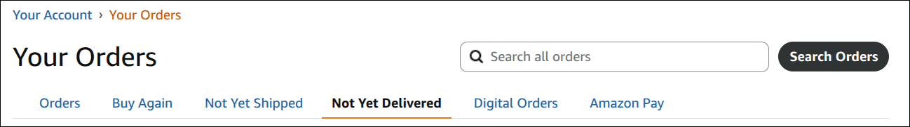

#  Amazon: Show orders not yet delivered

## Summary

Amazon's Your Orders page has a "Not Yet Shipped" tab, but no way to see
everything that still has deliveries pending.

This script adds a "Not Yet Delivered" tab that lists:

* Orders from the past 3 months with a shipment that hasn't arrived.
* All orders not yet shipped, from any date.

An order with multiple shipments shows only the pending shipments.

Amazon has no filter for this, so the tab loads your order pages in the
background, and takes a few seconds to fill in.

The script only supports amazon.com, in English.

**Example:**

## Visible changes

* A "Not Yet Delivered" tab after "Not Yet Shipped", on all Your Orders
  pages.
* On that tab, the matching order cards, with a loading message below them
  until they've all loaded. The time filter and page links are hidden.

## Implementation

### Why it uses hidden frames

* Order card contents are encrypted in the HTML (`.csd-encrypted-sensitive`
  nodes), and the page's own code decrypts them on load. A `fetch` of an
  orders page gets 10 cards with no status, title or items.
* The view's URL is the first page of recent orders, so the script waits for
  that page's own cards to decrypt and moves them into its list.
* The script loads each other list page in an offscreen same-origin iframe,
  waits for the cards to finish decrypting, and moves them into the main page.
  - `@noframes` keeps the script itself out of those frames.
  - Inline scripts in moved cards don't run a second time.
  - The controls checked after the move still work: "More options" and the
    "Ship to" popover. Amazon handles them through delegated listeners.
* A page counts as ready when `.js-yo-main-content` exists and no
  `.order-card .csd-encrypted-sensitive` remains. A sign-in or robot-check
  page never gets there, so it shows as a timeout error after 30 seconds.

### Which orders it lists

* `/your-orders/orders?timeFilter=months-3` gives recent orders, following
  `.a-pagination li.a-last a` until there's no next page. A card stays if
  any `.yohtmlc-shipment-status-primaryText` doesn't start with a status in
  `FINISHED_STATUS`, such as "Delivered" or "Return started".
  - Unknown wordings count as not delivered, so a new status can't hide an
    order. A status that wrongly shows up here means `FINISHED_STATUS` needs
    the new wording. Only "Delivered" and "Arriving" have been seen on real
    orders; the other wordings in the pattern are assumed.
* In the cards kept, each `.delivery-box` with a finished status is removed,
  along with the `hr` before it. The card's header still shows the whole
  order's total.
* `/your-orders/orders?orderFilter=open` gives not-yet-shipped orders. All of
  its cards stay, without a status check.
* Cards are deduplicated by the order ID in `data-csa-c-slot-id`. Open orders
  not already listed are older than 3 months, so appending them keeps the
  list newest first.

### The tab and the view

* Amazon also serves the same page at `/gp/css/order-history` (from the
  "Returns & Orders" link) and `/gp/your-account/order-history`, without
  redirecting, so the script matches `/gp/*/order-history` as well as
  `/your-orders/`.
* The tab is an `li.page-tabs__tab`, inserted after the one whose text is
  "Not Yet Shipped". On the view, it gets `page-tabs__tab--selected`, and
  the server's selected tab ("Orders") becomes a link.
* The view is the `notYetDelivered` URL parameter on the orders page, which
  Amazon ignores, so reload and back work.
* The script runs at `document-start` so it can hide the server's cards,
  `.js-time-filter-form` and `.a-pagination` before they paint. If a page has
  neither `.page-tabs` nor `.js-yo-main-content`, it shows them again.
* The page is over 1 MB and paints as it parses, so `DOMContentLoaded` comes
  after the tabs are on screen. A `MutationObserver` adds the tab as soon as
  "Not Yet Shipped" is parsed, then disconnects. On the view, the status line
  and list go in at that point too.
