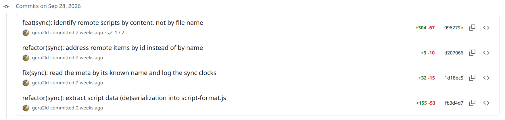

#  GitHub: Show line counts for each commit

## Summary

Commit pages show their line counts added and removed, but other pages
listing commits don't.

This script adds those counts (`+1,490 -785`) beside the short ID on
each commit in:

* A repository's commit history (`/commits/...`).
* A pull request's conversation timeline and its Commits tab.
* An issue's timeline.

Merge commits are shown in gray, since they're mostly double-counting what's
in other commits.

**Example:**

## Visible changes

* Green `+N` and red `-N` counts to the left of each commit's short
  sha.
* Gray counts on merge commits (more than one parent).
* Counts load as rows come near the screen, so a long list fills in as
  you scroll.

## Implementation

### Where the counts come from

`GET /<owner>/<repo>/commit/<sha>` with `Accept: application/json`
returns the commit page's React payload as JSON instead of HTML. It is
same-origin, so the page's cookies make it work for private repos too.
The script reads:

* `payload.commitRoute.headerInfo`: `additions` and `deletions`, the
  totals in the commit page's header.
* `payload.commitRoute.commit.parents`: a merge has more than one.

The payload is a few KB for a small commit and tens of KB for a large
one; the diffs themselves load separately (`asyncDiffLoadInfo`), so
it stays small. Fetches run four at a time, only for rows within
500px of the screen (an `IntersectionObserver`).

Commits never change, so each result is stored for good with
`GM_setValue`, one key per full sha holding `[additions, deletions,
isMerge]`. A commit is fetched once, then served from storage in any
tab, after reloads. Nothing is ever evicted; at ~60 bytes an entry,
that only matters after many thousands of commits.

Its `fetch` is same-origin and sends the page's cookies, which
private repos need.

### Rows we annotate

* **Commit history and PR Commits tab** (React):
  `li[data-testid="commit-row-item"][data-commit-link]`, where
  `data-commit-link` is `/<owner>/<repo>/commit/<sha>` or
  `/<owner>/<repo>/pull/<n>/commits/<sha>`. On the PR Commits tab the
  server renders `/commits/<sha>`, then the client re-renders the rows
  with `/pull/<n>/changes/<sha>`, so both forms are accepted. The counts go before the
  `div.d-flex` wrapping the short-sha link: the link in the row whose
  href ends with the sha and whose text is a prefix of it (the title
  link has the same href).
* **PR conversation** (server-rendered): `.TimelineItem .text-right
  code a[href*="/pull/"]` (`/pull/<n>/commits/<sha>` or `.../changes/<sha>`),
  the short-sha link at the right of each pushed commit. The "merged
  commit ... into main" event isn't matched; its count would just repeat
  the PR's total. The counts go before its `.text-right` wrapper.
* **Issue timeline** (React): `[class*="ReferencedEventInner-module"][class*="commitActions"]
  a[href*="/commit/"]`, the short-sha link on each "added a commit that
  references this issue" event. Its href is absolute
  (`https://github.com/<owner>/<repo>/commit/<sha>`), and the commit can
  be in another repo. The counts go just before the link.

### What we assume stays stable

* The JSON form of the commit page, and the `headerInfo` and
  `commit.parents` fields in it.
* The selectors above.

### How we modify the page

* A `` per row, inserted as
  a sibling before the sha link's wrapper. React ignores it; if React
  reuses the row for another commit, the next scan sees the `data-sha`
  mismatch and replaces it.
* A `MutationObserver` on `<html>` re-scans once per animation frame
  after DOM changes, which covers GitHub's in-page navigation and
  paging without any URL tracking.
* One `<style>` on `<html>`, using GitHub's `--fgColor-success`,
  `--fgColor-danger` and `--fgColor-muted` colors, so dark mode
  matches.
