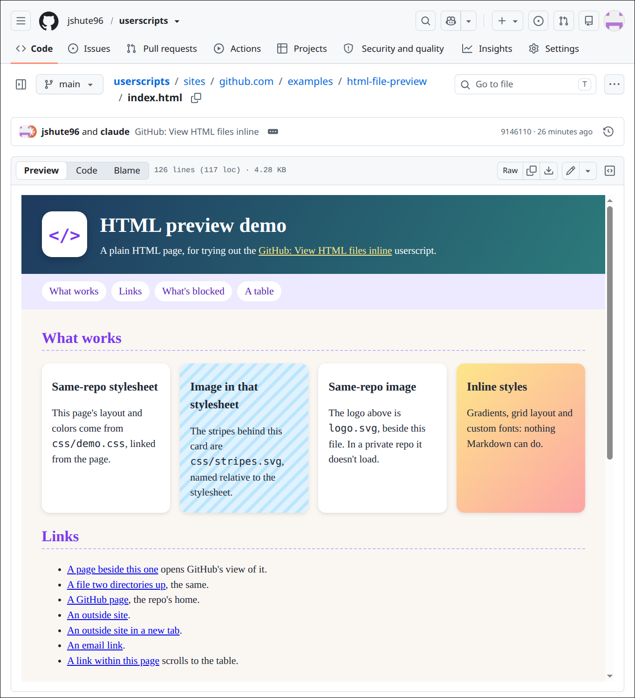

# GitHub: View HTML files inline

## Summary

GitHub shows `.md` files rendered, but doesn't render `.html` files.
Even the Raw button shows HTML source, not a rendered page.

This script adds an **HTML viewer that works inline, like the Markdown
viewer**. HTML gets the same *Preview&nbsp;|&nbsp;Code&nbsp;|&nbsp;Blame*
switch that Markdown has. *Preview* is selected by default.

The HTML is rendered in a sandbox, without its scripts and without
your GitHub cookies, so it can only access github.com like a logged-out user.

What works:
* Links (to other files and sites), links inside the page, same-repo styles, images from public repos.

What's blocked:
* Scripts, forms, images from private repos (they require GitHub cookies),
  fonts and styles loaded from other sites.

Static pages (reports, docs, generated tables) look as expected.
Pages that use JavaScript won't show their dynamic content.

**Example:**

## Visible changes

* A Preview item at the start of the Preview / Code / Blame switch on
  `.html` and `.htm` files, selected when the file opens, unless the
  file would show nothing without its scripts. It stays in
  the Blame view too, where it goes back to the file with the preview
  on.
* The rendered page in place of the code while Preview is selected, in
  a box that fills the rest of the window and scrolls. The GitHub page
  around it stops scrolling, unless the window is too short to leave
  the box 400px.

## Implementation

### What we observed

* **The file's text** is in the code view's hidden
  `textarea#read-only-cursor-text-area`, whole, with no fetch needed.
  Very large files may not get one; then we fetch the Raw link, which
  redirects to `raw.githubusercontent.com`.
* **The view switch** is `ul[aria-label="File view"]`, a Primer
  `SegmentedControl` with one `li` per view. The selected `li` has
  `data-selected`, and its `.segmentedControl-content` has
  `anchor-name: --segmented-control-current-item`, which the white knob
  is positioned against (CSS anchor positioning).
* **The code** is in `section[class*="BlobContent-module"]
  [class*="blobContentSection"]`. GitHub's CSS-module class names come
  in two forms depending on the build (`Module__name__hash` and
  `Module_hash_name`), so selectors match the two parts separately.
* **Raw** is `a[data-testid="raw-button"]`, with a
  `/<owner>/<repo>/raw/<ref>/<path>` href. Its directory is the base for
  the page's images and styles.
* **github.com's CSP** (Content-Security-Policy) is inherited by
  `srcdoc` frames. It allows only
  GitHub's own scripts, only inline styles, and images from github.com
  and a list of GitHub hosts.

### What we assume stays stable

* The textarea, the `File view` list and its `data-selected` /
  `anchor-name` styling, the `BlobContent` section, and the Raw
  button's test id.
* That GitHub keeps the header across in-page navigation (it does), so
  we take our additions out when leaving an `.html` file. The Blame view
  (`/blame/` in place of `/blob/`) keeps the same header; there,
  Preview clicks GitHub's own Code item to get back to the file, then
  turns the preview on.

### How we modify the page

* **Preview item**: a clone of one of GitHub's `li`s, prepended to the
  list. We set `data-selected` only on our own item. While previewing,
  a `<style>` of ours (switched with its `media` attribute) hides the code
  section and draws GitHub's selected item as unselected (its
  `anchor-name` off, and Primer's unselected padding and weight). We
  never change React's attributes: React reuses these `li`s for the
  next file, and a changed attribute it doesn't know about sticks.
  - Not an attribute on `<html>`: GitHub's React drops those when it
    takes over the server-rendered page, which turned a reloaded page
    back to Code. Our `<style>` elements on `<html>` survive it.
* **Header room**: in some builds the file header is `position:
  absolute` inside a sticky `.react-blob-view-header-sticky` of no
  height, and the code section leaves room for it. The pane gets a top
  margin of the header's height minus the sticky container's, so it
  isn't drawn under the header.
* **The page**: the source goes through `DOMParser` (which runs
  nothing) and is rewritten before display, so it can do nothing but
  show itself and follow clicked links. The sandbox and the CSP would
  stop most of this anyway; the rewrite doesn't lean on them alone.
  - `<script>`, `<meta http-equiv>` (refresh, CSP) and the file's own
    `<base>` are removed. Declarative shadow roots (`<template
    shadowrootmode>`) lose that attribute, so they stay inert templates
    and every link is in reach of the rewrite.
  - Our `<base>` is the raw file's directory, so relative images load
    from `github.com/<owner>/<repo>/raw/...`. The frame's requests go
    without the user's cookies, so this works only for public repos.
  - Stylesheets from the same repo are fetched and inlined as `<style>`,
    since the CSP blocks linked ones. We fetch them from the GitHub page,
    so they load from private repos too. At most 20, one at a time: each
    is a request with the user's cookies, made just by viewing the file.
    Relative `url()`s in them are rebased onto the stylesheet's own
    `github.com/.../raw/` URL, and `</style` becomes `<\/style`, so the
    text can't end its tag and slip markup past the rewrite. Other
    sites' stylesheets, and `@import`s, stay blocked.
  - Links (`<a>`, `<area>`, and SVG `<a>`, set with `setAttribute`
    since SVG's `href`/`target` properties are read-only): relative ones
    resolve against the file's own GitHub page
    (`/<owner>/<repo>/blob/<ref>/<dir>/`), so they open GitHub's view
    of the file they name. Only `http(s)`, `mailto` and `#` links are
    kept; others (`javascript:`, `data:`, ...) lose their `href`. `#x`
    links become `about:srcdoc#x`, since against our `<base>` they would
    load the raw file; this way they scroll the frame's own document. `ping`
    attributes (a POST on click) are removed. Links get `target="_top"`,
    so they open in the whole tab as on any page (the frame can't load
    github.com pages itself), or keep `_blank` if they had it.
* **The frame**: `<iframe sandbox="allow-popups
  allow-popups-to-escape-sandbox allow-top-navigation-by-user-activation"
  srcdoc=...>`. With no `allow-scripts`, nothing in it runs and forms
  are off; only a real click can follow a link, which the other three
  let through: into the GitHub tab, or a new tab that isn't sandboxed. With no `allow-same-origin`, the frame gets an origin of
  its own: even a sandbox bug couldn't reach the GitHub page or the
  user's session, and its requests carry no GitHub cookies.
  - So we can't read the frame's document to size it to its content,
    and it has no scripts to report its height. It scrolls itself.
  - Its height fills the window from the frame's top down, less what's
    below it in GitHub's box around the file (measured) and 8px. A
    `<style>` of ours (`html { overflow: hidden }`, switched with
    `media`) stops the GitHub page scrolling meanwhile. Under 400px of
    room, the frame gets 400px and the page scrolls as usual.
    Recomputed on resize and on the page's DOM changes.
* **Blank pages**: when the preview is on by default (not clicked),
  we check the file's `<body>` first. With scripts, styles and
  templates left out, no text and no images, media, frames or form
  controls means nothing would show, so we switch to Code instead.
  Clicking Preview on such a file shows an italic note in place of the
  frame: "No visible content to preview without running scripts.", or
  without "without running scripts" if the file has none (an empty page,
  or a redirect stub whose `<meta http-equiv="refresh">` we strip).
* **Start time**: `@run-at document-start`, and on an `.html` file the
  preview's `<style>` is on from the start, so a full page load (such as
  a link from one preview to another file) never shows the code first.
  The pane and an empty frame, already full height, go in as soon as the
  code section exists, so the box never starts short and grows. The
  frame gets its content once the document has finished parsing, since
  the file's textarea may be incomplete before then.
  - GitHub's React redraws the file area once during load, which takes
    our pane out. We put the same pane back rather than building it
    again.
  - While previewing with no pane in the page, the `MutationObserver`
    acts at once rather than on the next animation frame, so no frame is
    drawn without it.
* **In-page navigation**: the pane is only built once the Raw link
  names the current file (the header can briefly still be the previous
  file's), and a build that finishes after the user moved on is
  dropped.
* A `MutationObserver` on `<html>` re-checks after DOM changes (once
  per animation frame), covering GitHub's in-page navigation.
