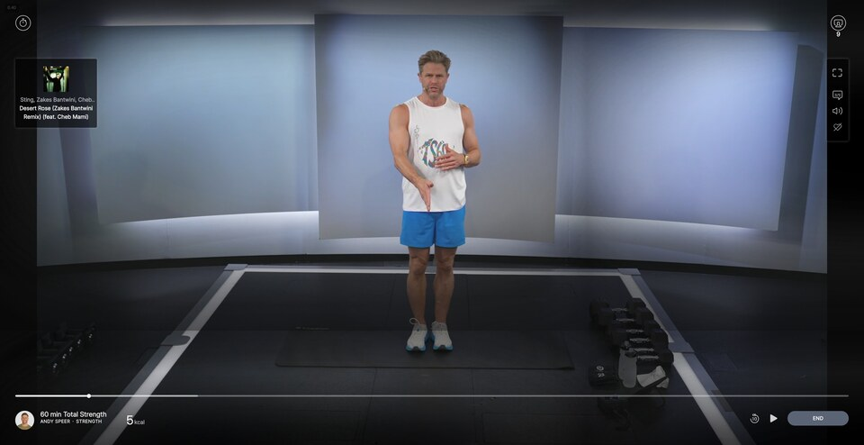
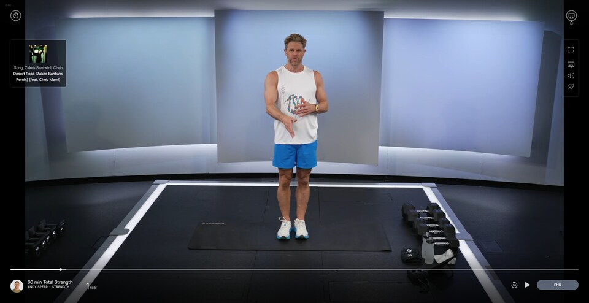

# Peloton Player: Fix bad video overlay on tall screens

## Summary

Fixes a bug in Peloton's class player that puts a hard
horizontal line across the video on large or high-resolution monitors.

Peloton paints a "cinematic vignette" image over the video to darken
its edges, but the image is a fixed 1920×1080 and is used at its
natural size ([example](https://members.onepeloton.com/_next/static/media/cf_video_overlay_with_timeline.6c8a2f88.png)). On any player taller than 
1080 pixels — normal on a 4K
or tall monitor — it covers only the top of the video, and the dark
band around its bottom edge lands mid-picture as a visible seam.

This script removes the overlay, so the video is drawn edge to edge at
full brightness. (Peloton's own controls and timeline are separate,
and are unaffected.)

<!-- image-gallery-heading: **Player, before and after:** -->

**Player before:**

**Player after:**

## Visible changes

- The cinematic-vignette dimming over the top of the player is
  gone — the video shows through at full brightness, edge to edge.
- The visible horizontal seam mid-video disappears with it.
- Everything else stays: JW Player's own controls, Peloton's song
  widget, the bottom controlbar dimming gradient, the metrics
  overlay, the side toolbar. Only the cinematic vignette is gone.

## Implementation

### What we observed

- The Peloton class player at `/classes/player/<classId>` renders
  JW Player inside a Peloton React wrapper. Peloton paints a
  page-sized `
` over the JW Player with a CSS background
  pointing at `/_next/static/media/cf_video_overlay_with_timeline.<hash>.png`.
- The element is one of a pair of styled-components divs (group
  hash `sc-b919e837-*`):
  - `-0` (e.g. `dfDvYD`): bottom 240px, `linear-gradient(rgba(0,0,0,0), rgba(0,0,0,0.6))` —
    the dim region behind the bottom control bar. We leave this alone.
  - `-1` (e.g. `jzUDu`): full player size, `background-image:
    url('.../cf_video_overlay_with_timeline.<hash>.png')` — the
    cinematic vignette. This is what we remove.
- The `background-image` comes from the props class's rule (e.g.
  `.jzUDu { ...; background-image: url(...); width: 100vw; height:
  100vh }`), which styled-components 5 adds with `insertRule` to the
  `<style data-styled>` sheet, so the tag's text is empty. A change in
  props gives a new class and a new rule. The divs' parent has a plain
  class, `player-overlay-wrapper`.
- The PNG is a vignette: dark perimeter, transparent oval in the
  middle. Natural size **1920×1080**, applied with `background-size:
  auto` (i.e. natural) and `background-position: 0 0`.
- The player wrapper's size depends on the browser viewport. On a
  wide-and-tall window (e.g. 1660 × 1459), the 1920×1080 PNG sits
  in the top-left at natural size, so:
  - It only covers player y=0..1080. Below y=1080: no overlay, full
    brightness.
  - The bottom edge of the PNG paints the **dark perimeter** part
    of the vignette, producing a hard horizontal seam between
    "dimmed by perimeter dark" (above y=1080) and "no overlay"
    (below). That seam is the artifact the user originally
    reported.
- On a player matching 1920×1080 exactly, the vignette fits and the
  seam isn't visible (it lines up with the edge of the player).
- On a smaller player, the PNG overflows beyond the player edges,
  the dim-perimeter region clips, and the seam is hidden by the
  natural framing — which is why this only appears at certain
  sizes.

The intent of the PNG is presumably a cinematic look — darkened
corners with the instructor in the bright middle. It's implemented
as a single fixed-resolution asset with no responsive sizing, so
it falls apart on any non-1080p viewing.

### What we assume stays stable

- The PNG's source filename `cf_video_overlay_with_timeline` stays
  the same across deploys. Only the content-hash suffix
  (`.6c8a2f88.png` at time of writing) changes when Peloton rebuilds.
  Identifying by filename substring is therefore stable across
  deploys but breaks if Peloton renames or splits the asset.
- The PNG continues to be applied as a `background-image` from a
  CSS rule the page can read (styled-components' sheet is same-origin).
  The fallback element scan also covers it being set inline on a
  regular `
`, but not an ``, an inline SVG, or a
  pseudo-element.
- The player is a SPA route under `members.onepeloton.com/*` —
  history-API navigation, not document reloads — so the script
  must re-scan on URL change.

### How we modify the page

- Find every CSS rule whose `background-image` contains
  `cf_video_overlay_with_timeline` and set `background-image: none
  !important` on the rule itself. That covers every element using it,
  including ones mounted later, whatever their class names.
  - At startup, and on each tick of the poll below, we walk
    `document.styleSheets` (including rules nested in `@media`).
  - We wrap `CSSStyleSheet.prototype.insertRule` (the script is
    `@grant none`, so it patches the page's own prototype) to fix
    matching rules as styled-components adds them, such as the new
    rule from a props change.
  - A `MutationObserver` on `<head>` checks new `<style>`/`<link>`
    sheets and text added to them, in case rules arrive as text.
- Earlier versions only scanned elements, for a while after load or a
  URL change, and later added a rule on the element's exact class
  names. The vignette still came back after going fullscreen again
  mid-class, with no URL change (not reproduced), probably from a
  re-mount with a new props class.
- Fallback: walk every `
`, and if its computed `backgroundImage`
  still contains the filename, set `background-image: none !important`
  inline and stamp it with `data-jshute-overlay-hidden`. This only
  finds anything when the rule fix didn't apply (a sheet we can't
  read, or an inline style).
- The element is rendered after route navigation completes, so we
  poll every 250ms for up to 10s, stopping once a rule has been fixed
  or an element marked. If no overlay is found on a player page, we
  log "gave up". The poll is re-armed on URL changes (hooked
  `pushState`/`replaceState` and `popstate`); once a rule is fixed,
  it stops on its first tick.
- We deliberately *don't* hide `cf_metrics_overlay_v_2.png` — a
  smaller (960×178) gradient PNG used as the backdrop for the
  metrics widget. The user only flagged the main vignette.
- Identifying by URL substring (rather than by class hash) is more
  resilient than `[class*="sc-b919e837"]`: the styled-components
  group ID rotates whenever Peloton rebuilds the component, but
  the source-asset filename only rotates if Peloton renames the
  file.

### Trade-off

- The vignette PNG is also the only carrier for the *cinematic*
  feel; once removed the player looks like a plain video pane.
  Given that the same PNG creates the bug on every non-1080p
  monitor, that's an acceptable trade.
- If Peloton later splits the timeline graphic out of this PNG
  into a separate element (which the filename `_with_timeline`
  suggests they sometimes need), this script will still work and
  the split-out timeline will keep rendering.
